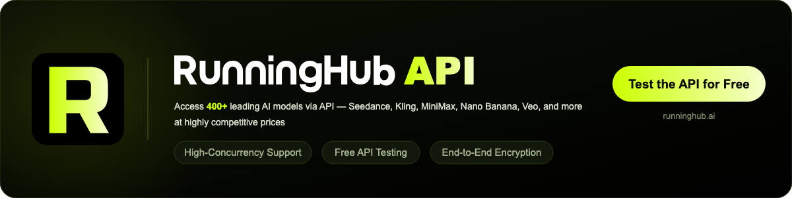
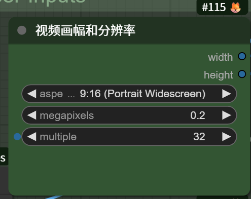
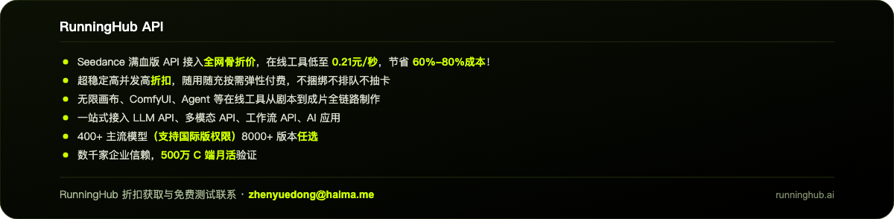

# 麦麦画师 · RunningHub


让麦麦亲手给你画画：从一句话文生图，到多参考图 / 视频生成，统统自动完成并把成品发回聊天。支持自定义工作流、自己优化成本、AI 扩写提示词和限流防刷。仅适配 NapCat / QQ。

平台入口：[RunningHub 国外](https://www.runninghub.ai?inviteCode=bvhsaqdr) / [RunningHub 国内](https://www.runninghub.cn?inviteCode=8cq8uhl8)

<p align="center">
  <a href="https://www.runninghub.ai/call-api?source=github"></a>
  <br>
  <sub>赞助支持 · 本项目由 RunningHub 提供支持 · 单一接口直连 400+ 主流大模型 · <a href="https://www.runninghub.ai/call-api?source=github">免费测试 API</a> · <a href="#赞助支持">了解 RunningHub 平台</a></sub>
</p>
**1.3.0 更新**：自然语言调用支持在同一条消息中向同一工作流提交多个不同任务，分别排队。完整变化见 [更新日志](CHANGELOG.md)。

**更新计划：**

- [x] 更好的自然语言调用
- [x] 模板工作流快速配置
- [ ] 更多更好的模板工作流（制作中，如有想要玩的或推荐的模型可以提issue，我有时间会添加）
- [ ] 喜欢请点个star，这对我很重要，球球了

> [!WARNING]
> 本插件目前**仅适配 NapCat 的 QQ**，其余平台 / 适配器未经测试，可能无法正常使用。

> [!IMPORTANT]
> RunningHub 是付费平台，每跑一次任务都会消耗你的账户余额 / 积分。建议装好后先在配置页「使用权限」里做好限制（见[进阶玩法](#进阶玩法)），限制谁能用、每小时最多跑几次，避免被群里的人刷爆余额。

---

## 目录

- [安装](#安装)
- [三步跑通第一张图](#装好之后三步跑通第一张图)
- [提示词扩写（可选）](#提示词扩写可选)
- [整理输入节点](#识别之后整理你的输入节点)
- [常用命令速查表](#常用命令速查表)
- [自然语言触发](#自然语言触发)
- [小白必懂的几个概念](#小白必懂的几个概念)
- [完整配置项参考](#完整配置项参考)
- [进阶玩法](#进阶玩法)
- [常见问题 FAQ](#常见问题-faq)
- [赞助支持](#赞助支持)
- [开发者：项目结构](#开发者项目结构)

---

## 这个插件能做什么

- ✅ **自然语言生成与修改**：文生图、图生图、视频、多参考图和可编辑参数
- ✅ 支持**文生图 / 图生图 / 文生视频 / 多参考生视频**等各类工作流，可配置多个
- ✅ **适配性**：这不是一个简单的生图/生视频插件，他的目标是**适配任意的工作流**
- ✅ **低成本**：出高清二次元 2K 图，一张约 25 RH 币（开会员约合 0.04 元）
- ✅ **高自由度**：RunningHub 上可以自定义各种工作流，不受插件配置限制，想出什么图都行
- ✅ 按配置好的**自定义提示词规则自动调用 LLM 扩写**，一句简单的话即可出高质量图
- ✅ 两种触发方式：**命令**和**自然语言**；聊天调用时可以直接用当前、引用、近期和上次生成的图片等素材
- ✅ 结果自动发送；可选「发完自动撤回」，保护你的隐私（仅 NapCat / QQ 适配器生效）
- ✅ 在 RunningHub 海外站配置好**鸭鸭加密**，可发送鸭鸭加密图（自行搜索鸭鸭加密内容，不提供教程）

---

## 安装

```bash
cd <MaiBot目录>/plugins
git clone https://github.com/achenjins/runninghub-workflow-adapter.git runninghub-workflow-adapter
pip install -r runninghub-workflow-adapter/requirements.txt
```

克隆并装好依赖后，重启 MaiBot（或在 WebUI 里热重载插件），插件即自动加载。

可选：再装上 Pillow（`pip install Pillow`），GIF 表情等平台不支持的图片会自动转成 PNG 再上传；不装时会提示用户换一张图。

---

## 装好之后：三步跑通第一张图

### 第 0 步：确认插件已加载

在聊天里发一句：

```text
/工作流
```

- 如果回复「尚未配置任何工作流」→ 插件已成功加载，继续下一步。
- 如果没反应 → 去 MaiBot 的插件 / 日志页面确认插件是否启用、有没有报错。

### 第 1 步：注册并填 API Key

这是最重要的一步，不填后面全都会失败。

**① 注册账号**（用邀请码注册，**获得 1000 RH 币！**）

打开对应平台的注册链接（邀请码已内置在链接里）：

- 国内站：[注册国内账号](https://www.runninghub.cn?inviteCode=8cq8uhl8) 国内邀请码：8cq8uhl8
- 海外站：[注册海外账号](https://www.runninghub.ai?inviteCode=bvhsaqdr) 海外邀请码：bvhsaqdr

**② 获取 API Key**

注册并登录后，打开对应平台的 API 页面，复制页面里的 API Key：

- 国内站：[打开国内 API 页面](https://www.runninghub.cn/enterprise-api/consumerApi?inviteCode=8cq8uhl8)
- 海外站：[打开海外 API 页面](https://www.runninghub.ai/enterprise-api/consumerApi?inviteCode=bvhsaqdr)

**③ 填进插件**

打开 MaiBot 的**插件配置页**，找到本插件的「平台连接」一栏：

- 用国内站（runninghub.cn）→ 把 Key 填进「国内密钥」
- 用海外站（runninghub.ai）→ 把 Key 填进「国外密钥」

两边账号和 Key 不通用，用哪个填哪个，也可以都填。

> [!TIP]
> 填完通常需要「重载插件」或「保存配置」才生效。

**④ 把自己设为管理员**

在聊天里识别导入工作流默认只有管理员能用。在同一页的「使用权限」→「管理员」里填上你自己的 QQ 号，否则下一步会提示「识别并写入工作流配置需要管理员权限」。

### 第 2 步：识别（导入）一个体验工作流

这里准备了两个体验工作流，任选一个即可，导入时插件会自动认出它们，直接套用调好的配置。

**① anima 提示词生图（二次元特化文生图，不支持参考图）**

这是我**删掉了内部高成本豆包提示词优化节点**的**文生图体验工作流**。注意：去掉提示词优化节点后，它不能直接在 RunningHub 页面上使用，要导入插件、配合插件的 LLM 扩写来用（导入时会自动开启）；想体验原版，可以去下方 up 主的视频里找完整版工作流。

- 海外版：[海外体验工作流](https://www.runninghub.ai/zh-cn/workflow/2087492768787685378?inviteCode=bvhsaqdr)
- 国内版：[国内体验工作流](https://www.runninghub.cn/workflow/2087939838371786753?inviteCode=8cq8uhl8)

> [!NOTE]
> 这个工作流魔改自 B 站视频教程 [BV1arGt6wExL](https://www.bilibili.com/video/BV1arGt6wExL)，感谢 up 主 [@每日提钢小助手5号](https://space.bilibili.com/3690999272442168) 分享的工作流，如侵权可联系删除。up 主的原版工作流自带提示词优化，运行时会额外消耗 RunningHub 余额。

**② qwen-image2.1 全能参考生图（支持参考图生图）**

- 海外版：[海外体验工作流](https://www.runninghub.ai/zh-cn/post/2112874041647345665?inviteCode=bvhsaqdr)
- 国内版：[国内体验工作流](https://www.runninghub.cn/post/2103013637228154881?inviteCode=8cq8uhl8)

> [!IMPORTANT]
> - qwen-image2.1 全能参考生图需要先在 RunningHub 页面上**保存为自己的工作流**，再用你账号下保存后的工作流 ID 识别导入。上面链接里的数字是作品页编号，不是工作流 ID，不能直接用来识别。
> - anima 提示词生图可以直接用下面例子里的 ID 导入；如果你另存了一份再修改，工作流 ID 会变成你账号下的新 ID，识别时记得换成新 ID。
> - 另存后的工作流照样能被认出是体验工作流；但如果改动了节点（增删节点、换节点类型），插件就认不出了，会按普通工作流识别。

填好 API Key 后，直接在聊天里发识别命令（按你的平台二选一）：

格式：`/识别国外工作流 工作流ID 自定义名称` 或 `/识别国内工作流 工作流ID 自定义名称`。导入 anima 提示词生图的例子：

```text
/识别国外工作流 2087492768787685378 文生图
```

```text
/识别国内工作流 2087939838371786753 文生图
```

导入 qwen-image2.1 全能参考生图时，把 ID 换成你保存后的工作流 ID，例如：

```text
/识别国内工作流 你保存后的工作流ID qwen全能参考
```

导入这两个体验工作流时，插件会回复「识别到模板工作流……已直接应用预设配置，具体配置可在插件配置页修改」。输入节点、扩写提示词和专属模板都已配好，可以直接跳到第 3 步；工作流名称、ID 和区域按你命令里填的保存。

> [!NOTE]
> 预设只在普通识别时套用；用 `/详细识别国外工作流` 或 `/详细识别国内工作流` 导入时，照常识别全部参数。

**导入你自己的工作流**：回复「识别成功」即导入完成，之后还要做两件事：

1. **检查输入节点**：进入 MaiBot 插件配置页 → 工作流列表，找到你刚导入的工作流，核对它的「主提示词」节点。其余需要用户修改的参数，输入类型可以保留为「可编辑参数」并填好默认值，自然语言调用会沿用默认值；无需暴露的固定参数可以直接在 RunningHub 里改好保存，或把输入类型改成「固定默认值」。
2. **配置提示词模板**：打开这个工作流的「扩写提示词」，在「自定义模板」里填模板文件路径（写法见下文[提示词扩写](#提示词扩写可选)）。体验工作流如果因为改过节点没被认出，可以直接用随插件提供的模板（在仓库的 `prompt/` 目录下）：
   - anima 提示词生图：`prompt/anima3_prompt_template.txt`
   - qwen-image2.1 全能参考生图：`prompt/qwen_image_prompt_template.md`（用法见 [Qwen Image 提示词优化模板](#内置模板qwen-image-21-提示词优化器)）

### 第 3 步：跑一张图

```text
/rh运行 文生图 原神刻晴
```

```text
/rh运行 文生图 原神刻晴与甘雨，室内
```

```
用你的工作流工具帮我画一张图，可莉与纳西妲一起炸鱼
给bot发送两张图片。图1，图2分别为角色的三视图，让这个两个角色贴贴
可以使用任何描述清楚的自然语言，bot会自动调用工具，生图，发送
```

- 如果这个工作流还需要**参考图 / 参考音频**，按提示发送文件。没开「必须提供内容」的输入（新节点默认不开）可以回「**跳过剩余**」跳过；开了的输入必须补齐。
- 如果识别出了一些**可修改参数**（如分辨率），机器人会问你「可修改：1.宽度=512 …」。按列出的顺序回复新值，用空格分隔，如「512 16:9」；某一项想保持默认就填 `-`，全部保持默认就回「**不变**」。有可选值的参数会逐行列出带序号的选项，在对应位置回序号即可，如「2」；序号超出范围或填了不在选项里的值，机器人会让你重新回复。
- 用 qwen-image2.1 全能参考生图时，机器人会先请你发参考图，按发送顺序依次对应图1～图6；只想文生图就回「**跳过剩余**」。

**设备与费用参考**（anima 提示词生图）：

- 推荐使用默认的 **Standard** 设备。
- 出图约 **2 分钟**。
- 平均消耗 **25 RH 币**，开通69元/月会员可获得36000rh币，可生成1440张图。约合 **0.05 元**一张，
- **使用我上面提供的邀请链接注册，可直接获得1000rh币！！！**最多支持生出40张图，每日签到还可获得100rh币。
- 注：**Ultra** 设备仅会员可用，且消耗较大。

然后等一会儿，结果会自动发回聊天窗口。🎉
**到这里，如果你使用的是我的工作流，那么恭喜你已经完成了配置，你的bot已经可以拥有生图功能，下面内容可不看**

---

## 提示词扩写（可选）

开启后，你只写「一只猫」也行：插件会先按模板把它扩写成一段完整的提示词，再提交给工作流，出图质量更高；不开启时，你写什么就原样传什么。

> [!TIP]
> 第 2 步的两个体验工作流导入时已经自动开启扩写、填好专属模板，不用再配置。如果它们因为改过节点没被认出，可以**跳过下面第 1 步**，直接把「自定义模板」填成对应模板：anima 提示词生图填 `prompt/anima3_prompt_template.txt`，qwen-image2.1 全能参考生图填 `prompt/qwen_image_prompt_template.md`。

**给自己的工作流开启（两步）**：

1. 在插件目录下新建一个模板文件（支持 `.txt` / `.md`），比如 `templates/my_template.txt`，写清楚「要 AI 怎么扩写」。写模板时注意：
   - 模板必须和工作流用的出图模型对得上，写得越详细越好
   - **建议找该模型的官方提示词指南、文档或 skill，让 AI 帮你总结成一份模板**
   - 扩写模型推荐 DeepSeek V4 Flash。

   一个简短示例：

       你是一位专业的 Stable Diffusion 提示词工程师。
       请把用户需求扩写成一段详细的英文提示词，必须包含：
       主体描述、画质词、构图、光影、风格、镜头。
       只输出提示词本身，不要解释。（这句话很重要）

2. 打开 MaiBot 插件配置页，找到对应工作流，打开「扩写提示词」，并在「自定义模板」里填 `templates/my_template.txt`（相对插件目录的路径）。

保存后，无论用 `/rh运行` 还是在聊天里提需求，都会先扩写提示词再出图。

**默认调用哪个模型**：扩写默认使用宿主的 `utils`。在配置页「辅助功能 → 提示词扩写模型」下拉选择 `replyer`、`planner`、`utils` 或 `vlm` 即可。扩写完成后，结果会填入主提示词节点，再提交生成。

### 内置模板：Qwen Image 2.1 提示词优化器

[`prompt/qwen_image_prompt_template.md`](prompt/qwen_image_prompt_template.md) 是给 Qwen Image 2.1 系列工作流（如 qwen-image2.1 全能参考生图）准备的扩写模板，规则来自 Qwen 官方的 PE-T2I / PE-I2I 系统提示词。它会自动判断任务类型：

- **没有参考图**：当作文生图，把一句话扩写成按画面区域、材质、光照逐项描述的长提示词。
- **有参考图**：当作图像编辑，按「改什么 → 保留什么」写编辑指令，用「图1、图2」指代参考图，人脸和产品外观只写「保持图N的……不变」，不用文字重新描述。

**在插件里使用**：

1. 在工作流配置里打开「扩写提示词」，「自定义模板」填 `prompt/qwen_image_prompt_template.md`（导入体验工作流时已自动填好）。
2. 像平时一样发需求即可，例如 `/rh运行 qwen全能参考 一个赛博朋克风格的城市夜景，有霓虹灯`，或在聊天里发图说「让图里这个人穿上第二张图的裙子」。
3. 需要时在需求里直接带上这些说法，模板会照做：
   - 「透明背景」：自动加上 RGBA 透明图需要的三句英文；
   - 「简短模式」：提示词压缩到 3～5 句；
   - 「用英文输出」：整段提示词改用英文（默认跟随你的输入语言）。

> [!TIP]
> 扩写模型看不到图片，只能依据插件提供的参考图说明。走自然语言调用时，插件会先用「聊天生成 → 视觉模型」给每张参考图生成一句简介，扩写更准；用 `/rh运行` 命令上传时只有图片数量，建议在描述里写清每张图是什么、要怎么用，例如「图1 是人物正面照，图2 是红色 V 领连衣裙，把图2 的裙子换到图1 人物身上」。


---

## 识别之后：整理你的输入节点

<details>
<summary>展开查看：节点怎么留、怎么删、漏了怎么补</summary>

用识别命令导入后，插件会自动列出一串「输入节点」。这些节点是插件按常见规则猜出来的，不一定完全符合你的需求，建议看一眼再正式用（体验工作流直接套用预设，一般不用整理）。

去哪看：**MaiBot 插件配置页 → 工作流列表 → 对应工作流 → 输入节点**。

### 哪些要保留、哪些可以删

按「输入类型」判断即可：

| 输入类型 | 建议 |
|---------|------|
| **主提示词**（prompt） | **必须保留**。这是你每次输入描述的位置，开启扩写后，扩写结果也会填到这里。一个工作流只能有一个主提示词节点 |
| **图片 / 音频 / 视频** | 需要传参考文件的就**保留**；不需要就删掉。参考文件固定不变的话，可以直接在工作流里传好保存 |
| **可编辑参数**（text） | 用 `/rh运行` 时每次都会问你的参数（分辨率、步数、CFG、种子、画师串提示词等）；聊天调用时沿用默认值，只改你明确提到的。**想自己控制就保留；嫌每次被问烦就删掉**；想固定住就改成「固定默认值」并填好值。不常改的（如分辨率）建议直接删掉，到 RunningHub 上改 |
| **固定默认值**（default） | 一般**保留**，直接用识别出的默认值；也可以删掉，改用工作流里的默认值 |

> [!WARNING]
> 输入类型别填错：插件靠它判断这个节点要的是图片、音频还是视频，用来引导你上传、区分文件种类。填错了会导致参考文件收错，甚至工作流报错。

**简单判断**：
- 你每次都要变的 → 留成「主提示词 / 图片 / 音频 / 视频 / 可编辑参数」
- 永远不动的 → 留成「固定默认值」，或干脆删掉
- 用不到的 → 直接删

> [!NOTE]
> 删节点只是让插件不再跟这个节点交互，不影响 RunningHub 上工作流本身。

### 识别漏了节点，怎么自己加

普通识别只认常见节点，遇到自定义节点可能漏掉。补法有两种：

1. **先用 `/详细识别国外工作流` 或 `/详细识别国内工作流` 重新导一遍**，它能识别更多参数（步数、采样器、CFG、种子、lora 强度等）。
2. **手动加**：在「输入节点」里点添加，主要填下面 5 项。



以上图「视频画幅和分辨率」节点（右上角 `#115`）为例：

| 字段 | 填什么 |
|------|--------|
| 节点编号 | 节点右上角的编号，如 `115` |
| 字段名 | 要控制的那一个参数名，如 `aspect_ratio`（宽高比）/ `megapixels`（像素）/ `multiple`（倍数） |
| 默认值 | 该参数的默认值，如 `9:16` / `0.2` / `32`；留空时沿用工作流里的原值（开启「必须提供内容」则要求用户补上） |
| 输入类型 | 固定不变选「固定默认值」；每次想改选「可编辑参数」 |
| 输入名称 | 可以自由填，给用户看的中文提示 |

> [!IMPORTANT]
> 一行只能填一个字段名。想同时控制宽高比、像素、倍数，就加三行，节点编号都填 `115`，字段名分别填 `aspect_ratio`、`megapixels`、`multiple`。

**节点编号和字段名从哪看**：打开 RunningHub 网站上的工作流，每个节点都有一个编号（就是「节点编号」），节点上要填内容的参数名就是「字段名」。图中右侧 `width` / `height` 是输出口，不是要填的输入。实在找不到，就先用详细识别命令自动填好，再照着改。

</details>

---

## 常用命令速查表

| 命令 | 作用 | 例子 |
|------|------|------|
| **/rh运行 工作流名 描述提示词** | 运行工作流生成图片 / 视频 | /rh运行 文生图 原神刻晴 |
| **/rh中断** | 中断任务：还在收集文件时直接结束；已提交的任务会列出编号，回复编号取消 | /rh中断 |
| **/工作流** | 列出已配置的工作流 | /工作流 |
| **/识别国外工作流 ID 名称** | 导入 runninghub.ai 上的工作流（关键节点；体验工作流直接套用预设） | /识别国外工作流 2087... 文生图 |
| **/识别国内工作流 ID 名称** | 导入 runninghub.cn 上的工作流（关键节点；体验工作流直接套用预设） | /识别国内工作流 2087... 文生图 |
| **/详细识别国外工作流 ID 名称** | 导入国外工作流，并识别**全部**参数 | /详细识别国外工作流 2087... 文生图 |
| **/详细识别国内工作流 ID 名称** | 导入国内工作流，并识别**全部**参数 | /详细识别国内工作流 2087... 文生图 |
| **/rh状态 [任务ID]** | 查看本会话任务，恢复对排队任务和已有平台任务的后台跟踪，不重新提交 | /rh状态 |
| **/rh补发 任务ID** | 只补发这个任务里还没确认发出的结果，不重新生成 | /rh补发 abc123 |
| **/rh核对 本地任务ID 平台编号\|未创建\|放弃** | 仅管理员：提交后没回应时，按 RunningHub 后台实际情况补登平台编号继续跟踪，或确认没创建、释放名额；查询被拒、暂停跟踪的任务可以放弃并释放名额 | /rh核对 abc123 未创建 |

> [!NOTE]
> **「识别」和「详细识别」的区别**：
> - 普通识别：只认最常用的（提示词、图片、音频、视频、分辨率、长宽比），对大多数场景够用。
> - 详细识别：还会把步数、采样器、CFG、种子、lora 强度等参数也识别出来，变成「每次跑之前可以改」的配置，适合想精细调参的人。
> - 体验工作流：普通识别直接套用调好的预设，详细识别不套用。

---

## 自然语言触发

配置好工作流的用途和输入节点后，直接在群里或私聊说需求就行：

```text
帮我画一张甘雨，蓝色长发，全身立绘
```

- 发图或引用图片时可以直接提要求：「把这张图改成水彩，保留人物和构图」；发两张图可以说「第一张作主体，第二张作风格」，没说清各张用途时会先问一句。
- 可以在上次结果上接着改：「根据上次生成结果，把背景改成蓝色」。
- 图生视频工作流给首帧、尾帧等输入填好「素材用途」后，也能用聊天触发；音频、视频可作为素材上传，目前不会识别音视频的内容。
- 可编辑参数只在你明确提及时修改（如「宽度 1024」），其余沿用默认值。
- 缺图片或缺必填内容时会引导你补，不会硬交任务。
- 插件按用户和会话记住最近用过及生成的图片，默认最多 20 张、最近使用后保留 24 小时（数量 0–20 可调，0 关闭并清空），每张附约 50 字简介；说「用我的头像画」就会用你自己的 QQ 头像，群里也能用群头像。
- 结果发回后机器人会按当前聊天语气再回一句，方便接着提要求。
- 也能直接管任务：「取消刚才那个」「第二张没收到，再发一次」。

不想让某个工作流出现在聊天调用里，关掉它的「允许聊天调用」即可（命令仍可用）。新增、改名或修改工作流后，在配置页保存即可生效，不用重载插件。

配置示例见 [多参考图配置示例](examples/natural-language.toml)；部署、任务状态含义和验收步骤见 [测试部署指南](docs/TESTING.md)。

---

## 小白必懂的几个概念

<details>
<summary>展开查看：工作流 ID / 区域 / 设备 / 节点类型</summary>

### 1. 工作流 ID 从哪找？

在 RunningHub 网站上打开工作流页面，看浏览器**地址栏**，里面有一长串数字（通常 19 位左右），那就是工作流 ID。把它复制下来即可。工作流保存后 ID 就固定了，不会再变。

注意：作品页（地址里是 `/post/`）上的数字是作品编号，不是工作流 ID。要先把作品保存为自己的工作流，再到工作流页面（地址里是 `/workflow/`）复制 ID。

### 2. 国内 / 国外怎么选？

- runninghub.ai 是国外站，runninghub.cn 是国内站，**账号和 API Key 不通用**。
- 工作流在哪个站打开的，就用哪个站的命令识别、填哪个站的 API Key。
- 如果填了 Key 却报「对应 API Key 未填写」，多半是区域和工作流对不上。

### 3. 设备类型选哪个？

导入时默认是 **Standard**（配置页显示为「标准」）。一般情况保持默认即可：

- **Standard（标准）**：最常用，推荐
- **Plus（增强）**：更快、配置更高，建议生视频时用
- **Ultra（旗舰）**：最高档位，**仅会员可用，消耗较大**

改设备：在 MaiBot 插件配置页「工作流列表」里，找到对应工作流的「运行设备」下拉改一下即可。

### 4. 输入类型是什么？

导入后，每个工作流会有一串「输入节点」，代表这个工作流要喂给它什么。每个节点的「输入类型」常见几种：

| 类型 | 一句话解释 | 运行时行为 |
|------|-----------|-----------|
| **主提示词**（prompt） | 你要生成什么 | 优先接收 `/rh运行` 后面的描述 / LLM 扩写文本；没输入时回退节点默认值；无默认值且没输入时会先询问描述；**整个工作流仅支持一个提示词输入节点** |
| **图片 / 音频 / 视频** | 要上传的参考文件 | 留空会引导你上传；填了默认值就直接用 |
| **可编辑参数**（text） | 每次可改的参数（如分辨率） | 自然语言默认沿用已有值，只覆盖明确指定的参数；命令交互仍提供配置确认 |
| **固定默认值**（default） | 固定参数（如分辨率、长宽比） | 直接用，不问你；没填默认值就跳过 |

> [!NOTE]
> 如果工作流有多个提示词输入（如正 / 负提示词），只保留一个「主提示词」（prompt），其余提示词改用「可编辑参数」（text）。扩写结果只会填进「主提示词」节点。

> [!TIP]
> 这些不用手动去理解原理：用识别命令导入后基本就自动填好了，需要微调再去插件配置页改。

</details>

---

## 完整配置项参考

<details>
<summary>展开查看：所有配置项与默认值</summary>

下面是插件配置页里的所有配置项，**绝大多数保持默认即可**，用到再改。

### 平台连接

| 配置项 | 默认值 | 说明 |
|--------|--------|------|
| 国外密钥 | 空 | 从国外平台个人中心获取 |
| 国内密钥 | 空 | 从国内平台个人中心获取 |

### 任务设置

| 配置项 | 默认值 | 说明 |
|--------|--------|------|
| 同时运行数 | 2 | 远端未结束的任务也占名额 |
| 最多排队数 | 10 | 运行名额之外允许等待的数量 |
| 文件上限（兆字节） | 64 | 单个输入或结果文件的大小上限 |
| 查询间隔（秒） | 15 | 查询远端任务进度的间隔 |
| 单轮查询时长（秒） | 1800 | 超时后继续跟踪，不重复生成 |
| 请求超时（秒） | 120 | 平台请求及文件传输的超时时间 |
| 查询重试次数 | 3 | 一轮查询中网络错误的重试次数 |
| 发送重试次数 | 2 | 明确失败才自动重试，状态未知时手动补发 |

### 辅助功能

| 配置项 | 默认值 | 说明 |
|--------|--------|------|
| 智能识别节点 | 开启 | 用 LLM 识别工作流节点，失败时改用节点规则 |
| 节点识别模型 | `utils` | 用于识别工作流输入与参数 |
| 提示词扩写模型 | `utils` | 各工作流可单独开启扩写 |
| 自动撤回结果 | 关闭 | 发送结果后自动撤回 |
| 撤回延迟（秒） | 90 | 填零不撤回 |

### 使用权限

| 配置项 | 默认值 | 说明 |
|--------|--------|------|
| 允许的用户 | 空 | 仅限制命令和其他插件调用，留空允许所有用户；不限制自然语言调用 |
| 允许的群 | 空 | 留空允许所有群，私聊不受此项限制 |
| 每人每小时次数 | 0 | 包含排队任务，填零不限次数 |
| 管理员 | 空 | 可导入工作流、取消当前会话里别人的任务，并在任意会话查看和核对等待处理的任务 |
| 仅管理员导入 | 开启 | 限制通过聊天识别并保存工作流 |
| 允许其他插件调用 | 关闭 | 允许其他插件代用户提交付费任务；调用方传入的用户和群不经验证，只在信任调用方时开启 |

> [!WARNING]
> 默认**全部放行**——任何能跟你机器人聊天的人都能触发任务（花你的钱）。建议至少填一个：要么加白名单，要么设个频率上限。

### 工作流

| 配置项 | 默认值 | 说明 |
|--------|--------|------|
| 工作流名称、编号 | 空 | 对应平台工作流，用于选择和运行 |
| 平台区域 | 国外 | 国外或国内 |
| 运行设备 | 标准 | 标准、增强、旗舰 |
| 用途说明 | 空 | 简要描述适用场景 |
| 工作流用途 | 自动判断 | 文字生图、图片编辑等用途 |
| 结果类型 | 图片 | 图片、视频、音频、文件 |
| 允许聊天调用 | 开启 | 关闭后仍可通过命令运行 |
| 扩写提示词 | 关闭 | 将用户描述整理为生成提示词 |
| 扩写方式 | 自动选择 | 自动选择、图片生成、图片编辑、视频生成、保留原文 |
| 自定义模板 | 空 | 相对于插件目录的模板文件路径 |
| 耗时与费用说明 | 空 | 供机器人选择时参考 |
| 输入节点 | 空 | 按需增加节点，或通过聊天识别导入 |

输入节点使用中文标题和下拉选项，包括输入名称、节点编号、字段名、输入类型、默认值、素材用途和参数校验等。「必须提供内容」默认关闭，开启后才要求补齐没有默认值的输入。只有「固定默认值」类型不允许工具修改。

### 聊天生成

| 配置项 | 默认值 | 说明 |
|--------|--------|------|
| 启用聊天生成 | 开启 | 允许通过自然语言生成或修改媒体 |
| 工作流选择模型 | `utils` | 多个候选且未指定名称时使用 |
| 视觉模型 | `vlm` | 对应宿主的视觉模型，可下拉更换 |
| 最近图片数量 | 20 | 每人每个会话最多保存的原图及约 50 字简介，0～20，填零关闭并清空 |
| 图片保留时间（秒） | 86400 | 按最近使用时间保留 24 小时，独立于临时上下文；可调小 |
| 允许使用头像 | 开启 | 把当前用户和群头像加入素材候选 |
| 参考消息数 | 20 | 从当前会话读取的最近消息条数 |
| 素材候选上限 | 12 | 普通素材候选数量，已保存的最近图片另计 |
| 临时素材保留时间（秒） | 3600 | 普通素材、待补需求与临时上下文的保留时间；识图简介单独按图片保留时间计时 |
| 模型超时（秒） | 45 | 工作流选择、识图和扩写的等待上限 |

模型下拉只有 `replyer`、`planner`、`utils`、`vlm` 四个选项，配置文件里也保存这四个名称；旧版配置里的「回复模型」「规划模型」「通用模型」「视觉模型」仍能读取，保存时会自动换成对应名称。其余下拉选项在配置页都显示为中文。完整配置见 `config.example.toml`。

聊天工具分开查询：`rh_workflows` 默认只列工作流用途、输出类型与素材需求，指定 `workflow_name` 后才返回该工作流的输入和参数；`rh_media` 只列素材 ID、来源、时间与最多 50 字简介，可按来源和类型筛选。`source="memory"` 直接查询保存图片，不读取聊天历史。已保存图片使用稳定 ID，`rh_inspect_media` 与 `run_workflow` 可省略 `context_id`；旧临时上下文过期后也能继续使用仍在保留期内的图片。简单需求仍可直接调用 `run_workflow`。生成时仍需定位本次触发消息以防止重复提交；宿主消息和聊天历史均不可用时，请重新发送需求或使用 `/rh运行`，查询与观察保存图片不受影响。缓存图片可与当前或引用消息的素材混用。

图片按用户和会话隔离，默认最多 20 张，距最近使用超过 24 小时的图片不可再通过缓存读取，并在访问或定期清理时删除无引用文件。数量淘汰时保护排队任务和待补需求使用的图片，生成结果优先淘汰，不挤掉参考图；数量上限和时间上限始终生效。视频和语音仍只做元信息与用途绑定，不加入图片记忆。已有配置显式设置的图片数量保持不变，升级时可将 `natural_language.recent_images` 调为 20。

</details>

---

## 进阶玩法

<details>
<summary>展开查看：使用权限与自动撤回</summary>

### 限制谁能用 / 防刷爆余额

在配置页「使用权限」里：

- **限制命令和其他插件调用的用户**：「允许的用户」填用户号码（每行一个），自然语言调用不受此项限制。
- **只让指定群用**：「允许的群」填群号（每行一个）。
- **限频**：「每人每小时次数」填一个数，比如 5，每人每小时最多跑 5 次（排队中的也算）。

自然语言调用仅受「允许的群」和「每人每小时次数」限制；命令和其他插件调用保留原有的用户白名单、群白名单与次数限制。

群聊工具优先使用宿主提供的当前用户或消息身份；宿主只提供会话身份时，沿用最近入站消息的发言人记录。群内多人聊天不会阻止自然语言调用；宿主已指定请求人时，后来的其他发言不会改变本次任务的归属和次数。

其他插件调用 `run_workflow_api` 默认关闭；需要时在「使用权限」里打开「允许其他插件调用」。调用方传入的用户和群不经宿主验证，只在信任调用方插件时开启。

### 自动撤回（仅 NapCat / QQ）

如果你用的是 NapCat 适配器，在「辅助功能」里打开「自动撤回结果」并设好「撤回延迟（秒）」，结果发出去后会自动撤回。

撤回计划只保存在内存里：插件重载或 MaiBot 重启时，还没到时间的撤回不会再执行。

</details>

---

## 常见问题 FAQ

<details>
<summary>展开查看：常见问题排查</summary>

**Q：跑一次要花钱吗？**
A：要。RunningHub 按任务消耗余额 / 积分，每跑一次都会扣。所以建议先在「使用权限」里做好限制。

**Q：报「没有使用本插件的权限」？**
A：「使用权限」里设了白名单，你的用户号码或当前群不在里面，请管理员加上。另外，通过聊天识别导入工作流默认只有「管理员」能用（「仅管理员导入」默认开启）。

**Q：报「对应 API Key 未填写」？**
A：这个工作流的「平台区域」是国内，但「平台连接」里没填「国内密钥」（或反过来）。检查两边是否对得上。

**Q：识别结果为空 / 识别不出节点？**
A：普通识别只认关键节点，有些自定义节点认不到。改用 `/详细识别国外工作流` 或 `/详细识别国内工作流`，或去插件配置页手动加节点。

**Q：识别时报「识别出多个主提示词节点」？**
A：识别结果有一定随机性，偶尔会把多个文字节点都当成主提示词。重新识别一次；仍不行就到插件配置页手动配置输入节点。

**Q：导入体验工作流时没有提示「识别到模板工作流」？**
A：插件按节点编号和节点类型认模板，工作流改动过节点（增删节点、换节点类型）就认不出，会按普通工作流识别；用详细识别命令导入也不会套用模板。

**Q：上传文件后没反应？**
A：确认插件已重载，再看日志里有没有「已接收输入」或「任务已提交」。

**Q：提示词扩写没生效？**
A：确认这个工作流的「扩写提示词」已打开，「自定义模板」填的文件确实存在；没填模板时按「扩写方式」的内置策略扩写，选「保留原文」则不扩写。再检查「辅助功能 → 提示词扩写模型」选的模型是否可用。

**Q：为什么我说话没触发生成？**
A：确认「聊天生成」里的「启用聊天生成」已打开，工作流的「允许聊天调用」已打开，「工作流用途」和各节点的输入类型填对了，并在 MaiBot 里允许了插件的自然语言工具。首次升级后需要重载插件，之后改工作流配置会自动生效。如果提示身份无法确认或素材已过期，按提示重新发送需求或文件。

**Q：结果图片想让它自己删掉？**
A：这是「自动撤回结果」功能，仅 NapCat / QQ 适配器可用，在「辅助功能」里开启并设好撤回延迟。

</details>

---

## 赞助支持

<p align="center">
  <a href="https://www.runninghub.ai/call-api?source=github"></a>
  <br>
  <b>RunningHub API</b>
  <br>
  本项目由 RunningHub 提供支持 · 单一接口直连 400+ 主流大模型 · <a href="https://www.runninghub.ai/call-api?source=github">免费测试</a>
</p>

<a href="https://www.runninghub.ai/call-api?source=github"></a>

- Seedance 满血版 API 接入**全网骨折价**，在线工具低至 **0.21元/秒**，节省 **60%–80% 成本**！
- 超稳定高并发高**折扣**，随用随充按需弹性付费，不捆绑不排队不抽卡
- 无限画布、ComfyUI、Agent 等在线工具从剧本到成片全链路制作
- 一站式接入 LLM API、多模态 API、工作流 API、AI 应用
- 400+ 主流模型（**支持国际版权限**），8000+ 版本**任选**
- 数千家企业信赖，**500 万 C 端月活**验证

RunningHub 折扣获取与免费测试联系：[zhenyuedong@haima.me](mailto:zhenyuedong@haima.me)

免费测试 API：<https://www.runninghub.ai/call-api?source=github>

---

## 开发者：项目结构

<details>
<summary>展开查看：模块划分与任务日志（v1.3.0）</summary>

插件入口负责配置、命令和宿主适配；主要逻辑位于 `rh_generic_lib/`。自然语言工具模块使用 MaiBot SDK，其余核心模块采用可注入接口：

- `workflow_runner.py`：节点类型解析、nodeInfoList 构建、结果 URL 分类、消耗解析
- `session_machine.py`：交互式收集会话数据结构与查找规则
- `file_source.py`：消息文件提取、base64 / URL / 本地路径读取；上传前按文件内容检查格式，只放行 RunningHub 支持的 JPG/PNG/WEBP、MP3/WAV/FLAC、MP4/AVI/MOV/MKV，QQ 语音先经 NapCat `get_record` 转成 MP3，GIF 和转不出来的语音会提示用户换格式
- `delivery.py`：NapCat 直发、回退发送、定时撤回
- `task_journal.py`：任务日志持久化
- `task_runtime.py` / `task_queue.py`：持久化排队、额度预约、并发限制、恢复与补发
- `media_context.py`：当前、引用、近期和生成结果素材的会话隔离及读取
- `media_plan.py`：工作流能力、角色绑定、默认值和参数校验
- `natural_language.py`：工作流概要/详情、素材查询、看图、运行、任务管理工具
- `workflow_presets.py`：体验工作流的节点指纹与预设配置；普通识别时按「节点编号 → 节点类型」匹配，不依赖工作流 ID
- `background_io.py`：把任务日志、最近图片等阻塞写盘放进线程，收到取消时等写完再抛出

提交走的是 RunningHub 工作流页面「API 调用」示例里的 `POST /openapi/v2/run/workflow/{工作流ID}`（官方 API 文档目录里没有单独列出这个端点）。参数按文档「发起ComfyUI任务2-高级」填写：Standard 不传 `instanceType`，使用平台默认的 24G 机器；Plus、Ultra 分别传 `plus`、`ultra`；`addMetadata` 固定为 `false`，成品图里不写入提示词等元信息。

任务日志默认写入插件 `runtime_dir/task_journal.json`。先持久化 `queued` 和额度预约，再执行上传与提交；远端任务 ID 单独记录。生成状态与发送状态分开保存，重启后恢复查询及确定未发送的结果；已发送项不会重复补发。提交响应丢失记为 `unknown_submission`，不会自动重新提交。日志损坏或无法写入时拒绝新付费任务。

`/rh状态 [任务ID]` 查看状态，`/rh中断` 取消自己的任务，`/rh补发 任务ID` 只补发尚未确认发送的结果。发送状态未知时应先确认是否已收到，再手动补发；网络条件下无法保证发送严格恰好一次。管理员确认 RunningHub 记录后，可用 `/rh核对 本地任务ID 远端任务ID` 关联任务，或 `/rh核对 本地任务ID 未创建` 释放保留名额；查询被拒后暂停的任务不再需要时，用 `/rh核对 本地任务ID 放弃` 释放名额。

</details>

---

## 许可证

MIT

原访问统计链接（备用，恢复后可替换回顶部）：[count.kjchmc.cn](https://count.kjchmc.cn/get/@rhaajinse?theme=gelbooru)
